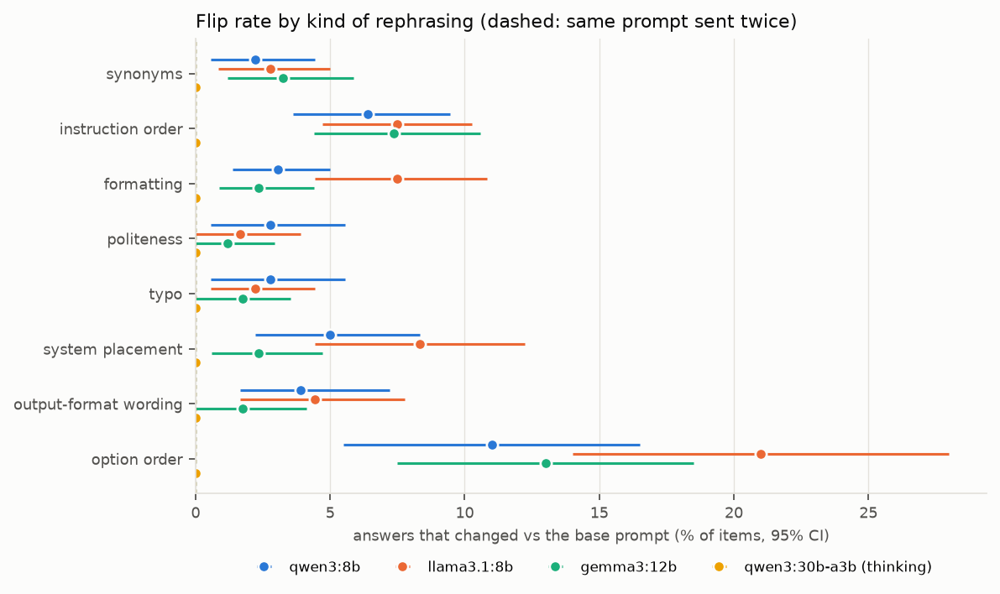
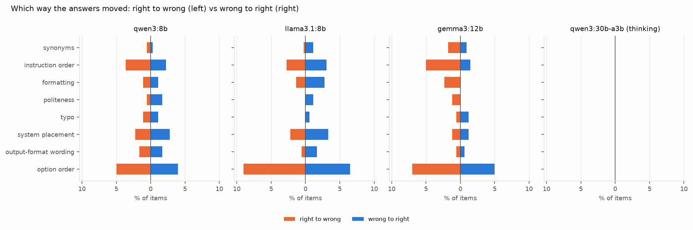
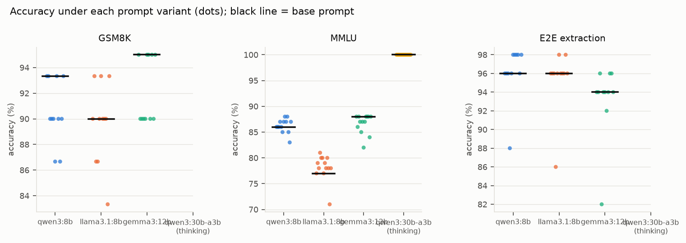
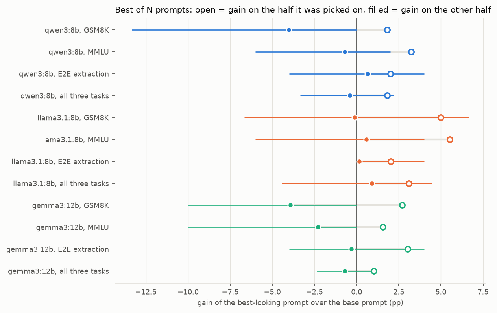

# Results

Generated by `uv run brittle report` from `results/answers/*.jsonl` and `data/items.jsonl`. Every number below is computed by code from cached model outputs. Intervals are 95% percentile bootstraps (2,000 resamples) over items, stratified by task when tasks are pooled; `pp` = percentage points. Every stored output is re-parsed with the current parser when this report is built.

## Headline

- **qwen3:8b** (180 items): averaged over all rephrasings, the answer changed on 4.5% [2.6, 6.5] of items (same prompt sent twice: 0.0% [0.0, 0.0]). Right to wrong 2.0% [0.9, 3.3], wrong to right 1.7% [0.6, 3.2]. 18% of items gave more than one distinct answer across the prompts, and 16% were right under some prompts and wrong under others.
- **llama3.1:8b** (180 items): averaged over all rephrasings, the answer changed on 6.6% [4.7, 8.8] of items (same prompt sent twice: 0.0% [0.0, 0.0]). Right to wrong 1.9% [1.2, 2.7], wrong to right 2.4% [1.3, 3.7]. 29% of items gave more than one distinct answer across the prompts, and 27% were right under some prompts and wrong under others.
- **gemma3:12b** (170 items): averaged over all rephrasings, the answer changed on 4.3% [2.8, 6.0] of items (same prompt sent twice: 0.0% [0.0, 0.0]). Right to wrong 2.7% [1.5, 4.2], wrong to right 1.2% [0.5, 2.2]. 21% of items gave more than one distinct answer across the prompts, and 19% were right under some prompts and wrong under others.
- **qwen3:30b-a3b (thinking)** (6 items): averaged over all rephrasings, the answer changed on 0.0% [0.0, 0.0] of items (same prompt sent twice: 0.0% [0.0, 0.0]). Right to wrong 0.0% [0.0, 0.0], wrong to right 0.0% [0.0, 0.0]. 0% of items gave more than one distinct answer across the prompts, and 0% were right under some prompts and wrong under others.

- **qwen3:8b**, kinds whose flip rate is above the A/A repeat (interval of the excess above zero): option order, instruction order, system placement, output-format wording, formatting, politeness, typo, synonyms. Largest: option order 11.0% [5.5, 16.5]; instruction order 6.4% [3.6, 9.4]; system placement 5.0% [2.2, 8.3].
- **llama3.1:8b**, kinds whose flip rate is above the A/A repeat (interval of the excess above zero): option order, system placement, instruction order, formatting, output-format wording, synonyms, typo. Largest: option order 21.0% [14.0, 28.0]; system placement 8.3% [4.4, 12.2]; instruction order 7.5% [4.7, 10.3].
- **gemma3:12b**, kinds whose flip rate is above the A/A repeat (interval of the excess above zero): option order, instruction order, synonyms, formatting, system placement. Largest: option order 13.0% [7.5, 18.5]; instruction order 7.4% [4.4, 10.6]; synonyms 3.2% [1.2, 5.9].
- **qwen3:30b-a3b (thinking)**, kinds whose flip rate is above the A/A repeat (interval of the excess above zero): none. Largest: synonyms 0.0% [0.0, 0.0]; instruction order 0.0% [0.0, 0.0]; formatting 0.0% [0.0, 0.0].

- **qwen3:8b**, best of 11 prompt wordings for all three tasks together: picked on half the items it looks +1.8 pp better than the base prompt; on the other half it is -0.4 pp (middle 95% of 2,000 random splits: -3.3 to +2.2).
- **llama3.1:8b**, best of 11 prompt wordings for all three tasks together: picked on half the items it looks +3.1 pp better than the base prompt; on the other half it is +0.9 pp (middle 95% of 2,000 random splits: -4.4 to +4.4).
- **gemma3:12b**, best of 11 prompt wordings for all three tasks together: picked on half the items it looks +1.0 pp better than the base prompt; on the other half it is -0.7 pp (middle 95% of 2,000 random splits: -2.4 to +1.2).

## 1. Setup

| model | digest | think | calls | calls per task (GSM8K / MMLU / E2E) | median server seconds per call | mean output tokens | hit the length cap |
|---|---|---|---|---|---|---|---|
| qwen3:8b | 500a1f067a9f | False | 2360 | 360 / 1400 / 600 | 12.5 / 0.9 / 3.6 | 59 | 0.9% |
| llama3.1:8b | 46e0c10c039e | None | 2360 | 360 / 1400 / 600 | 11.0 / 0.6 / 4.2 | 47 | 0.6% |
| gemma3:12b | b92b218582c5 | None | 2240 | 240 / 1400 / 600 | 8.3 / 0.9 / 5.9 | 40 | 0.0% |
| qwen3:30b-a3b (thinking) | ad815644918f | True | 84 | 0 / 84 / 0 | - / 9.5 / - | 715 | 0.0% |

Items analysed (complete under every variant): 30 GSM8K, 100 MMLU (high school biology, high school geography, high school macroeconomics, high school psychology), 50 E2E extraction, out of 300 sampled. Prompt variants per item: base, A/A repeat, and 10 rephrasings (12 for MMLU, which adds two option orders). Items completed by every main model (qwen3:8b, llama3.1:8b, gemma3:12b): 20 GSM8K, 100 MMLU, 50 E2E extraction.

Base-prompt accuracy and which parsing rule produced the answer:

| model | task | items | accuracy | parse rule |
|---|---|---|---|---|
| qwen3:8b | GSM8K | 30 | 93.3% [83.3, 100.0] | cue 57%, boxed 43% |
| qwen3:8b | MMLU | 100 | 86.0% [79.0, 92.0] | cue 99%, none 1% |
| qwen3:8b | E2E extraction | 50 | 96.0% [90.0, 100.0] | json 100% |
| llama3.1:8b | GSM8K | 30 | 90.0% [76.7, 100.0] | cue 97%, last number 3% |
| llama3.1:8b | MMLU | 100 | 77.0% [69.0, 85.0] | cue 98%, none 1%, answer is 1% |
| llama3.1:8b | E2E extraction | 50 | 96.0% [90.0, 100.0] | json 100% |
| gemma3:12b | GSM8K | 20 | 95.0% [85.0, 100.0] | cue 100% |
| gemma3:12b | MMLU | 100 | 88.0% [82.0, 94.0] | cue 99%, none 1% |
| gemma3:12b | E2E extraction | 50 | 94.0% [88.0, 100.0] | json 100% |
| qwen3:30b-a3b (thinking) | MMLU | 6 | 100.0% [100.0, 100.0] | cue 100% |

## 2. Noise floor: the same prompt sent twice

The base prompt is sent a second time with a separate cache entry (temperature 0, same seed), spread through the run so it shares the server with different neighbours. A rephrasing only counts as having an effect when its flip rate exceeds this repeat with an interval above zero (paired by item).

| model | items | answers changed | flip rate | accuracy change |
|---|---|---|---|---|
| qwen3:8b | 180 | 0 | 0.0% [0.0, 0.0] | +0.0 pp |
| llama3.1:8b | 180 | 0 | 0.0% [0.0, 0.0] | +0.0 pp |
| gemma3:12b | 170 | 0 | 0.0% [0.0, 0.0] | +0.0 pp |
| qwen3:30b-a3b (thinking) | 6 | 0 | 0.0% [0.0, 0.0] | +0.0 pp |

## 3. Which kinds of rephrasing matter

Flip rate = share of items whose parsed answer differs from the base prompt's answer (no answer counts as an answer). For kinds with two variants, an item's value is the mean over both. `excess` = flip rate minus the A/A repeat on the same items. `*` marks kinds whose excess interval is above zero. Option order applies to MMLU only, so its rows cover the MMLU items only.



**qwen3:8b**

| kind | items | flip rate | excess over A/A | right to wrong | wrong to right | accuracy change |
|---|---|---|---|---|---|---|
| synonyms * | 180 | 2.2% [0.6, 4.4] | +2.2 pp [+0.6, +4.4] | 0.6% [0.0, 1.4] | 0.3% [0.0, 0.8] | -0.3 pp [-1.1, +0.6] |
| instruction order * | 180 | 6.4% [3.6, 9.4] | +6.4 pp [+3.6, +9.4] | 3.6% [1.7, 6.1] | 2.2% [0.8, 4.2] | -1.4 pp [-4.2, +1.4] |
| formatting * | 180 | 3.1% [1.4, 5.0] | +3.1 pp [+1.4, +5.0] | 1.1% [0.3, 2.2] | 1.1% [0.0, 2.5] | +0.0 pp [-1.7, +1.7] |
| politeness * | 180 | 2.8% [0.6, 5.6] | +2.8 pp [+0.6, +5.6] | 0.6% [0.0, 1.7] | 1.7% [0.0, 3.9] | +1.1 pp [-0.6, +3.3] |
| typo * | 180 | 2.8% [0.6, 5.6] | +2.8 pp [+0.6, +5.6] | 1.1% [0.0, 2.8] | 1.1% [0.0, 2.8] | +0.0 pp [-2.2, +2.2] |
| system placement * | 180 | 5.0% [2.2, 8.3] | +5.0 pp [+2.2, +8.3] | 2.2% [0.6, 4.4] | 2.8% [0.6, 5.6] | +0.6 pp [-2.2, +3.9] |
| output-format wording * | 180 | 3.9% [1.7, 7.2] | +3.9 pp [+1.7, +7.2] | 1.7% [0.0, 3.9] | 1.7% [0.0, 3.9] | +0.0 pp [-2.8, +2.8] |
| option order * | 100 | 11.0% [5.5, 16.5] | +11.0 pp [+5.5, +16.5] | 5.0% [1.5, 9.5] | 4.0% [1.0, 7.5] | -1.0 pp [-6.5, +4.0] |

**llama3.1:8b**

| kind | items | flip rate | excess over A/A | right to wrong | wrong to right | accuracy change |
|---|---|---|---|---|---|---|
| synonyms * | 180 | 2.8% [0.8, 5.0] | +2.8 pp [+0.8, +5.0] | 0.3% [0.0, 0.8] | 1.1% [0.0, 2.8] | +0.8 pp [-0.3, +2.5] |
| instruction order * | 180 | 7.5% [4.7, 10.3] | +7.5 pp [+4.7, +10.3] | 2.8% [1.4, 4.4] | 3.1% [1.4, 4.7] | +0.3 pp [-2.2, +2.8] |
| formatting * | 180 | 7.5% [4.4, 10.8] | +7.5 pp [+4.4, +10.8] | 1.4% [0.3, 2.8] | 2.8% [1.1, 5.0] | +1.4 pp [-0.8, +3.9] |
| politeness | 180 | 1.7% [0.0, 3.9] | +1.7 pp [+0.0, +3.9] | 0.0% [0.0, 0.0] | 1.1% [0.0, 2.8] | +1.1 pp [+0.0, +2.8] |
| typo * | 180 | 2.2% [0.6, 4.4] | +2.2 pp [+0.6, +4.4] | 0.0% [0.0, 0.0] | 0.6% [0.0, 1.7] | +0.6 pp [+0.0, +1.7] |
| system placement * | 180 | 8.3% [4.4, 12.2] | +8.3 pp [+4.4, +12.2] | 2.2% [0.6, 4.4] | 3.3% [1.1, 6.1] | +1.1 pp [-2.2, +5.0] |
| output-format wording * | 180 | 4.4% [1.7, 7.8] | +4.4 pp [+1.7, +7.8] | 0.6% [0.0, 1.7] | 1.7% [0.0, 3.9] | +1.1 pp [-0.6, +3.3] |
| option order * | 100 | 21.0% [14.0, 28.0] | +21.0 pp [+14.0, +28.0] | 9.0% [4.0, 14.0] | 6.5% [3.0, 10.5] | -2.5 pp [-9.0, +4.0] |

**gemma3:12b**

| kind | items | flip rate | excess over A/A | right to wrong | wrong to right | accuracy change |
|---|---|---|---|---|---|---|
| synonyms * | 170 | 3.2% [1.2, 5.9] | +3.2 pp [+1.2, +5.9] | 1.8% [0.3, 3.8] | 0.9% [0.0, 2.4] | -0.9 pp [-3.2, +1.2] |
| instruction order * | 170 | 7.4% [4.4, 10.6] | +7.4 pp [+4.4, +10.6] | 5.0% [2.6, 7.9] | 1.5% [0.3, 2.9] | -3.5 pp [-6.8, -0.6] |
| formatting * | 170 | 2.4% [0.9, 4.4] | +2.4 pp [+0.9, +4.4] | 2.4% [0.9, 4.4] | 0.0% [0.0, 0.0] | -2.4 pp [-4.4, -0.9] |
| politeness | 170 | 1.2% [0.0, 2.9] | +1.2 pp [+0.0, +2.9] | 1.2% [0.0, 2.9] | 0.0% [0.0, 0.0] | -1.2 pp [-2.9, +0.0] |
| typo | 170 | 1.8% [0.0, 3.5] | +1.8 pp [+0.0, +3.5] | 0.6% [0.0, 1.8] | 1.2% [0.0, 2.9] | +0.6 pp [-1.2, +2.4] |
| system placement * | 170 | 2.4% [0.6, 4.7] | +2.4 pp [+0.6, +4.7] | 1.2% [0.0, 2.9] | 1.2% [0.0, 2.9] | +0.0 pp [-2.4, +2.4] |
| output-format wording | 170 | 1.8% [0.0, 4.1] | +1.8 pp [+0.0, +4.1] | 0.6% [0.0, 1.8] | 0.6% [0.0, 1.8] | +0.0 pp [-1.8, +1.8] |
| option order * | 100 | 13.0% [7.5, 18.5] | +13.0 pp [+7.5, +18.5] | 7.0% [3.0, 11.5] | 5.0% [2.0, 9.0] | -2.0 pp [-8.0, +4.0] |

**qwen3:30b-a3b (thinking)**

| kind | items | flip rate | excess over A/A | right to wrong | wrong to right | accuracy change |
|---|---|---|---|---|---|---|
| synonyms | 6 | 0.0% [0.0, 0.0] | +0.0 pp [+0.0, +0.0] | 0.0% [0.0, 0.0] | 0.0% [0.0, 0.0] | +0.0 pp [+0.0, +0.0] |
| instruction order | 6 | 0.0% [0.0, 0.0] | +0.0 pp [+0.0, +0.0] | 0.0% [0.0, 0.0] | 0.0% [0.0, 0.0] | +0.0 pp [+0.0, +0.0] |
| formatting | 6 | 0.0% [0.0, 0.0] | +0.0 pp [+0.0, +0.0] | 0.0% [0.0, 0.0] | 0.0% [0.0, 0.0] | +0.0 pp [+0.0, +0.0] |
| politeness | 6 | 0.0% [0.0, 0.0] | +0.0 pp [+0.0, +0.0] | 0.0% [0.0, 0.0] | 0.0% [0.0, 0.0] | +0.0 pp [+0.0, +0.0] |
| typo | 6 | 0.0% [0.0, 0.0] | +0.0 pp [+0.0, +0.0] | 0.0% [0.0, 0.0] | 0.0% [0.0, 0.0] | +0.0 pp [+0.0, +0.0] |
| system placement | 6 | 0.0% [0.0, 0.0] | +0.0 pp [+0.0, +0.0] | 0.0% [0.0, 0.0] | 0.0% [0.0, 0.0] | +0.0 pp [+0.0, +0.0] |
| output-format wording | 6 | 0.0% [0.0, 0.0] | +0.0 pp [+0.0, +0.0] | 0.0% [0.0, 0.0] | 0.0% [0.0, 0.0] | +0.0 pp [+0.0, +0.0] |
| option order | 6 | 0.0% [0.0, 0.0] | +0.0 pp [+0.0, +0.0] | 0.0% [0.0, 0.0] | 0.0% [0.0, 0.0] | +0.0 pp [+0.0, +0.0] |

Of the 51 E2E answers (all models, all rephrasings) that changed, 19 (37%) differ from the base answer only by generic words such as "food", "the" or "restaurant" ("English food" against "English"): the span the model copied moved, not the fact. They still count as flips, and as wrong when the gold is the shorter span, because the field rule is exact match.

By task (flip rate, the main models averaged per item, on the items all of them completed):

| kind | GSM8K | MMLU | E2E extraction |
|---|---|---|---|
| synonyms | 5.0% [0.8, 10.0] | 2.5% [1.2, 4.2] | 2.0% [0.0, 4.0] |
| instruction order | 6.7% [0.8, 14.2] | 5.7% [3.5, 8.0] | 10.0% [5.7, 14.7] |
| formatting | 3.3% [0.0, 7.5] | 5.8% [3.5, 8.3] | 1.3% [0.0, 3.3] |
| politeness | 3.3% [0.0, 8.3] | 2.3% [0.7, 4.3] | 0.7% [0.0, 2.0] |
| typo | 1.7% [0.0, 5.0] | 1.7% [0.3, 3.3] | 2.7% [0.7, 5.3] |
| system placement | 10.0% [3.3, 18.3] | 5.0% [2.7, 7.7] | 2.7% [0.7, 5.3] |
| output-format wording | 6.7% [1.7, 13.3] | 3.3% [1.3, 5.7] | 1.3% [0.0, 3.3] |
| option order |  | 15.0% [10.3, 19.5] |  |
| identity (A/A) | 0.0% [0.0, 0.0] | 0.0% [0.0, 0.0] | 0.0% [0.0, 0.0] |

## 4. Right to wrong vs wrong to right

Shares of all items. Conditional rates: of the items the base prompt got right, how many a rephrasing got wrong, and of those it got wrong, how many a rephrasing fixed.



| model | right to wrong | wrong to right | net accuracy change | P(wrong | base right) | P(right | base wrong) |
|---|---|---|---|---|---|
| qwen3:8b | 2.0% [0.9, 3.3] | 1.7% [0.6, 3.2] | -0.3 pp [-2.0, +1.5] | 2.2% [1.1, 3.6] | 16.9% [7.7, 27.5] |
| llama3.1:8b | 1.9% [1.2, 2.7] | 2.4% [1.3, 3.7] | +0.5 pp [-1.0, +2.1] | 2.3% [1.4, 3.2] | 15.4% [9.7, 21.9] |
| gemma3:12b | 2.7% [1.5, 4.2] | 1.2% [0.5, 2.2] | -1.5 pp [-3.2, +0.1] | 3.0% [1.6, 4.6] | 12.9% [6.0, 19.8] |
| qwen3:30b-a3b (thinking) | 0.0% [0.0, 0.0] | 0.0% [0.0, 0.0] | +0.0 pp [+0.0, +0.0] | 0.0% [0.0, 0.0] | n/a |

## 5. Accuracy spread

Per item, over the base prompt and its rephrasings (A/A repeat excluded).



| model | task | always right | always wrong | right under some prompts only | more than one answer | worst prompt | best prompt | range |
|---|---|---|---|---|---|---|---|---|
| qwen3:8b | E2E extraction | 84% | 0% | 16% | 16% | 88% | 98% | 10 pp |
| qwen3:8b | GSM8K | 87% | 3% | 10% | 13% | 87% | 93% | 7 pp |
| qwen3:8b | MMLU | 76% | 7% | 17% | 20% | 83% | 88% | 5 pp |
| llama3.1:8b | E2E extraction | 82% | 0% | 18% | 18% | 86% | 98% | 12 pp |
| llama3.1:8b | GSM8K | 77% | 3% | 20% | 23% | 83% | 93% | 10 pp |
| llama3.1:8b | MMLU | 61% | 6% | 33% | 37% | 71% | 81% | 10 pp |
| gemma3:12b | E2E extraction | 80% | 2% | 18% | 18% | 82% | 96% | 14 pp |
| gemma3:12b | GSM8K | 90% | 0% | 10% | 10% | 90% | 95% | 5 pp |
| gemma3:12b | MMLU | 74% | 5% | 21% | 24% | 82% | 88% | 6 pp |
| qwen3:30b-a3b (thinking) | MMLU | 100% | 0% | 0% | 0% | 100% | 100% | 0 pp |

<details><summary>Accuracy per variant, qwen3:8b</summary>

| task | variant | kind | accuracy | vs base | flip rate | right to wrong (items) | wrong to right (items) | no answer parsed |
|---|---|---|---|---|---|---|---|---|
| GSM8K | base | base | 93.3% [83, 100] |  | 0.0% | 0 | 0 | 0.0% |
| GSM8K | syn1 | synonyms | 93.3% [83, 100] | +0.0 pp [+0.0, +0.0] | 0.0% | 0 | 0 | 0.0% |
| GSM8K | syn2 | synonyms | 90.0% [80, 100] | -3.3 pp [-10.0, +0.0] | 6.7% | 1 | 0 | 0.0% |
| GSM8K | order1 | instruction order | 90.0% [80, 100] | -3.3 pp [-10.0, +0.0] | 3.3% | 1 | 0 | 0.0% |
| GSM8K | order2 | instruction order | 90.0% [80, 100] | -3.3 pp [-13.3, +6.7] | 10.0% | 2 | 1 | 0.0% |
| GSM8K | bullets | formatting | 86.7% [73, 97] | -6.7 pp [-16.7, +0.0] | 6.7% | 2 | 0 | 0.0% |
| GSM8K | marker | formatting | 93.3% [83, 100] | +0.0 pp [+0.0, +0.0] | 3.3% | 0 | 0 | 0.0% |
| GSM8K | polite | politeness | 90.0% [80, 100] | -3.3 pp [-10.0, +0.0] | 3.3% | 1 | 0 | 0.0% |
| GSM8K | typo | typo | 86.7% [73, 97] | -6.7 pp [-16.7, +0.0] | 6.7% | 2 | 0 | 0.0% |
| GSM8K | system | system placement | 90.0% [80, 100] | -3.3 pp [-13.3, +6.7] | 10.0% | 2 | 1 | 0.0% |
| GSM8K | outfmt | output-format wording | 93.3% [83, 100] | +0.0 pp [-10.0, +10.0] | 6.7% | 1 | 1 | 0.0% |
| GSM8K | aa | identity (A/A) | 93.3% [83, 100] | +0.0 pp [+0.0, +0.0] | 0.0% | 0 | 0 | 0.0% |
| MMLU | base | base | 86.0% [79, 92] |  | 0.0% | 0 | 0 | 1.0% |
| MMLU | syn1 | synonyms | 86.0% [79, 92] | +0.0 pp [-3.0, +3.0] | 4.0% | 1 | 1 | 2.0% |
| MMLU | syn2 | synonyms | 86.0% [79, 92] | +0.0 pp [+0.0, +0.0] | 2.0% | 0 | 0 | 2.0% |
| MMLU | order1 | instruction order | 87.0% [80, 93] | +1.0 pp [-3.0, +5.0] | 6.0% | 2 | 3 | 1.0% |
| MMLU | order2 | instruction order | 86.0% [79, 92] | +0.0 pp [-3.0, +3.0] | 3.0% | 1 | 1 | 1.0% |
| MMLU | bullets | formatting | 85.0% [78, 92] | -1.0 pp [-3.0, +0.0] | 2.0% | 1 | 0 | 1.0% |
| MMLU | marker | formatting | 87.0% [80, 93] | +1.0 pp [-2.0, +4.0] | 4.0% | 1 | 2 | 1.0% |
| MMLU | polite | politeness | 88.0% [81, 94] | +2.0 pp [+0.0, +5.0] | 3.0% | 0 | 2 | 1.0% |
| MMLU | typo | typo | 87.0% [80, 93] | +1.0 pp [+0.0, +3.0] | 2.0% | 0 | 1 | 1.0% |
| MMLU | system | system placement | 88.0% [81, 94] | +2.0 pp [-2.0, +6.0] | 4.0% | 1 | 3 | 1.0% |
| MMLU | outfmt | output-format wording | 85.0% [78, 92] | -1.0 pp [-4.0, +2.0] | 4.0% | 2 | 1 | 0.0% |
| MMLU | shuf_rev | option order | 83.0% [75, 90] | -3.0 pp [-9.0, +3.0] | 11.0% | 6 | 3 | 1.0% |
| MMLU | shuf_rand | option order | 87.0% [80, 93] | +1.0 pp [-5.0, +7.0] | 11.0% | 4 | 5 | 2.0% |
| MMLU | aa | identity (A/A) | 86.0% [79, 92] | +0.0 pp [+0.0, +0.0] | 0.0% | 0 | 0 | 1.0% |
| E2E extraction | base | base | 96.0% [90, 100] |  | 0.0% | 0 | 0 | 0.0% |
| E2E extraction | syn1 | synonyms | 96.0% [90, 100] | +0.0 pp [+0.0, +0.0] | 0.0% | 0 | 0 | 0.0% |
| E2E extraction | syn2 | synonyms | 96.0% [90, 100] | +0.0 pp [+0.0, +0.0] | 0.0% | 0 | 0 | 0.0% |
| E2E extraction | order1 | instruction order | 88.0% [78, 96] | -8.0 pp [-20.0, +2.0] | 16.0% | 6 | 2 | 0.0% |
| E2E extraction | order2 | instruction order | 96.0% [90, 100] | +0.0 pp [-6.0, +6.0] | 4.0% | 1 | 1 | 0.0% |
| E2E extraction | bullets | formatting | 98.0% [94, 100] | +2.0 pp [+0.0, +6.0] | 2.0% | 0 | 1 | 0.0% |
| E2E extraction | marker | formatting | 98.0% [94, 100] | +2.0 pp [+0.0, +6.0] | 2.0% | 0 | 1 | 0.0% |
| E2E extraction | polite | politeness | 98.0% [94, 100] | +2.0 pp [+0.0, +6.0] | 2.0% | 0 | 1 | 0.0% |
| E2E extraction | typo | typo | 98.0% [94, 100] | +2.0 pp [+0.0, +6.0] | 2.0% | 0 | 1 | 0.0% |
| E2E extraction | system | system placement | 96.0% [90, 100] | +0.0 pp [-6.0, +6.0] | 4.0% | 1 | 1 | 0.0% |
| E2E extraction | outfmt | output-format wording | 98.0% [94, 100] | +2.0 pp [+0.0, +6.0] | 2.0% | 0 | 1 | 0.0% |
| E2E extraction | aa | identity (A/A) | 96.0% [90, 100] | +0.0 pp [+0.0, +0.0] | 0.0% | 0 | 0 | 0.0% |

</details>

<details><summary>Accuracy per variant, llama3.1:8b</summary>

| task | variant | kind | accuracy | vs base | flip rate | right to wrong (items) | wrong to right (items) | no answer parsed |
|---|---|---|---|---|---|---|---|---|
| GSM8K | base | base | 90.0% [77, 100] |  | 0.0% | 0 | 0 | 0.0% |
| GSM8K | syn1 | synonyms | 93.3% [83, 100] | +3.3 pp [+0.0, +10.0] | 6.7% | 0 | 1 | 0.0% |
| GSM8K | syn2 | synonyms | 86.7% [73, 97] | -3.3 pp [-10.0, +0.0] | 6.7% | 1 | 0 | 0.0% |
| GSM8K | order1 | instruction order | 86.7% [73, 97] | -3.3 pp [-10.0, +0.0] | 10.0% | 1 | 0 | 0.0% |
| GSM8K | order2 | instruction order | 90.0% [77, 100] | +0.0 pp [+0.0, +0.0] | 6.7% | 0 | 0 | 0.0% |
| GSM8K | bullets | formatting | 93.3% [83, 100] | +3.3 pp [+0.0, +10.0] | 10.0% | 0 | 1 | 0.0% |
| GSM8K | marker | formatting | 90.0% [77, 100] | +0.0 pp [+0.0, +0.0] | 3.3% | 0 | 0 | 0.0% |
| GSM8K | polite | politeness | 90.0% [77, 100] | +0.0 pp [+0.0, +0.0] | 0.0% | 0 | 0 | 0.0% |
| GSM8K | typo | typo | 90.0% [77, 100] | +0.0 pp [+0.0, +0.0] | 3.3% | 0 | 0 | 0.0% |
| GSM8K | system | system placement | 83.3% [70, 97] | -6.7 pp [-20.0, +6.7] | 16.7% | 3 | 1 | 0.0% |
| GSM8K | outfmt | output-format wording | 93.3% [83, 100] | +3.3 pp [+0.0, +10.0] | 6.7% | 0 | 1 | 0.0% |
| GSM8K | aa | identity (A/A) | 90.0% [77, 100] | +0.0 pp [+0.0, +0.0] | 0.0% | 0 | 0 | 0.0% |
| MMLU | base | base | 77.0% [69, 85] |  | 0.0% | 0 | 0 | 1.0% |
| MMLU | syn1 | synonyms | 79.0% [71, 87] | +2.0 pp [+0.0, +5.0] | 4.0% | 0 | 2 | 2.0% |
| MMLU | syn2 | synonyms | 78.0% [70, 86] | +1.0 pp [+0.0, +3.0] | 2.0% | 0 | 1 | 1.0% |
| MMLU | order1 | instruction order | 81.0% [73, 88] | +4.0 pp [-1.0, +10.0] | 9.0% | 2 | 6 | 2.0% |
| MMLU | order2 | instruction order | 80.0% [72, 87] | +3.0 pp [+0.0, +7.0] | 4.0% | 0 | 3 | 1.0% |
| MMLU | bullets | formatting | 80.0% [72, 87] | +3.0 pp [+0.0, +7.0] | 6.0% | 0 | 3 | 0.0% |
| MMLU | marker | formatting | 77.0% [69, 85] | +0.0 pp [-6.0, +6.0] | 16.0% | 5 | 5 | 0.0% |
| MMLU | polite | politeness | 79.0% [71, 87] | +2.0 pp [+0.0, +5.0] | 3.0% | 0 | 2 | 2.0% |
| MMLU | typo | typo | 78.0% [69, 86] | +1.0 pp [+0.0, +3.0] | 3.0% | 0 | 1 | 0.0% |
| MMLU | system | system placement | 80.0% [72, 88] | +3.0 pp [-1.0, +8.0] | 9.0% | 1 | 4 | 1.0% |
| MMLU | outfmt | output-format wording | 78.0% [70, 86] | +1.0 pp [-2.0, +5.0] | 5.0% | 1 | 2 | 0.0% |
| MMLU | shuf_rev | option order | 71.0% [62, 80] | -6.0 pp [-15.0, +2.0] | 24.0% | 12 | 6 | 1.0% |
| MMLU | shuf_rand | option order | 78.0% [70, 86] | +1.0 pp [-6.0, +7.0] | 18.0% | 6 | 7 | 2.0% |
| MMLU | aa | identity (A/A) | 77.0% [69, 85] | +0.0 pp [+0.0, +0.0] | 0.0% | 0 | 0 | 1.0% |
| E2E extraction | base | base | 96.0% [90, 100] |  | 0.0% | 0 | 0 | 0.0% |
| E2E extraction | syn1 | synonyms | 96.0% [90, 100] | +0.0 pp [+0.0, +0.0] | 0.0% | 0 | 0 | 0.0% |
| E2E extraction | syn2 | synonyms | 96.0% [90, 100] | +0.0 pp [+0.0, +0.0] | 0.0% | 0 | 0 | 0.0% |
| E2E extraction | order1 | instruction order | 86.0% [76, 94] | -10.0 pp [-22.0, +0.0] | 18.0% | 7 | 2 | 0.0% |
| E2E extraction | order2 | instruction order | 96.0% [90, 100] | +0.0 pp [+0.0, +0.0] | 0.0% | 0 | 0 | 0.0% |
| E2E extraction | bullets | formatting | 98.0% [94, 100] | +2.0 pp [+0.0, +6.0] | 2.0% | 0 | 1 | 0.0% |
| E2E extraction | marker | formatting | 96.0% [90, 100] | +0.0 pp [+0.0, +0.0] | 0.0% | 0 | 0 | 0.0% |
| E2E extraction | polite | politeness | 96.0% [90, 100] | +0.0 pp [+0.0, +0.0] | 0.0% | 0 | 0 | 0.0% |
| E2E extraction | typo | typo | 96.0% [90, 100] | +0.0 pp [+0.0, +0.0] | 0.0% | 0 | 0 | 0.0% |
| E2E extraction | system | system placement | 98.0% [94, 100] | +2.0 pp [+0.0, +6.0] | 2.0% | 0 | 1 | 0.0% |
| E2E extraction | outfmt | output-format wording | 96.0% [90, 100] | +0.0 pp [+0.0, +0.0] | 2.0% | 0 | 0 | 0.0% |
| E2E extraction | aa | identity (A/A) | 96.0% [90, 100] | +0.0 pp [+0.0, +0.0] | 0.0% | 0 | 0 | 0.0% |

</details>

<details><summary>Accuracy per variant, gemma3:12b</summary>

| task | variant | kind | accuracy | vs base | flip rate | right to wrong (items) | wrong to right (items) | no answer parsed |
|---|---|---|---|---|---|---|---|---|
| GSM8K | base | base | 95.0% [85, 100] |  | 0.0% | 0 | 0 | 0.0% |
| GSM8K | syn1 | synonyms | 90.0% [75, 100] | -5.0 pp [-15.0, +0.0] | 5.0% | 1 | 0 | 0.0% |
| GSM8K | syn2 | synonyms | 90.0% [75, 100] | -5.0 pp [-15.0, +0.0] | 5.0% | 1 | 0 | 0.0% |
| GSM8K | order1 | instruction order | 90.0% [75, 100] | -5.0 pp [-15.0, +0.0] | 5.0% | 1 | 0 | 0.0% |
| GSM8K | order2 | instruction order | 90.0% [75, 100] | -5.0 pp [-15.0, +0.0] | 5.0% | 1 | 0 | 0.0% |
| GSM8K | bullets | formatting | 95.0% [85, 100] | +0.0 pp [+0.0, +0.0] | 0.0% | 0 | 0 | 0.0% |
| GSM8K | marker | formatting | 95.0% [85, 100] | +0.0 pp [+0.0, +0.0] | 0.0% | 0 | 0 | 0.0% |
| GSM8K | polite | politeness | 90.0% [75, 100] | -5.0 pp [-15.0, +0.0] | 5.0% | 1 | 0 | 0.0% |
| GSM8K | typo | typo | 95.0% [85, 100] | +0.0 pp [+0.0, +0.0] | 0.0% | 0 | 0 | 0.0% |
| GSM8K | system | system placement | 90.0% [75, 100] | -5.0 pp [-15.0, +0.0] | 5.0% | 1 | 0 | 0.0% |
| GSM8K | outfmt | output-format wording | 95.0% [85, 100] | +0.0 pp [-15.0, +15.0] | 10.0% | 1 | 1 | 0.0% |
| GSM8K | aa | identity (A/A) | 95.0% [85, 100] | +0.0 pp [+0.0, +0.0] | 0.0% | 0 | 0 | 0.0% |
| MMLU | base | base | 88.0% [82, 94] |  | 0.0% | 0 | 0 | 1.0% |
| MMLU | syn1 | synonyms | 86.0% [79, 92] | -2.0 pp [-5.0, +0.0] | 3.0% | 2 | 0 | 0.0% |
| MMLU | syn2 | synonyms | 88.0% [82, 94] | +0.0 pp [+0.0, +0.0] | 0.0% | 0 | 0 | 1.0% |
| MMLU | order1 | instruction order | 87.0% [80, 93] | -1.0 pp [-6.0, +4.0] | 9.0% | 4 | 3 | 0.0% |
| MMLU | order2 | instruction order | 85.0% [78, 91] | -3.0 pp [-7.0, +0.0] | 3.0% | 3 | 0 | 1.0% |
| MMLU | bullets | formatting | 87.0% [81, 93] | -1.0 pp [-3.0, +0.0] | 1.0% | 1 | 0 | 1.0% |
| MMLU | marker | formatting | 82.0% [75, 89] | -6.0 pp [-11.0, -2.0] | 6.0% | 6 | 0 | 1.0% |
| MMLU | polite | politeness | 87.0% [80, 93] | -1.0 pp [-3.0, +0.0] | 1.0% | 1 | 0 | 1.0% |
| MMLU | typo | typo | 88.0% [82, 94] | +0.0 pp [+0.0, +0.0] | 0.0% | 0 | 0 | 1.0% |
| MMLU | system | system placement | 88.0% [82, 94] | +0.0 pp [-3.0, +3.0] | 2.0% | 1 | 1 | 1.0% |
| MMLU | outfmt | output-format wording | 88.0% [82, 94] | +0.0 pp [+0.0, +0.0] | 1.0% | 0 | 0 | 0.0% |
| MMLU | shuf_rev | option order | 84.0% [76, 91] | -4.0 pp [-12.0, +4.0] | 18.0% | 10 | 6 | 1.0% |
| MMLU | shuf_rand | option order | 88.0% [82, 94] | +0.0 pp [-5.0, +5.0] | 8.0% | 4 | 4 | 1.0% |
| MMLU | aa | identity (A/A) | 88.0% [82, 94] | +0.0 pp [+0.0, +0.0] | 0.0% | 0 | 0 | 1.0% |
| E2E extraction | base | base | 94.0% [88, 100] |  | 0.0% | 0 | 0 | 0.0% |
| E2E extraction | syn1 | synonyms | 94.0% [86, 100] | +0.0 pp [-6.0, +6.0] | 6.0% | 1 | 1 | 0.0% |
| E2E extraction | syn2 | synonyms | 96.0% [90, 100] | +2.0 pp [-4.0, +8.0] | 6.0% | 1 | 2 | 0.0% |
| E2E extraction | order1 | instruction order | 82.0% [72, 92] | -12.0 pp [-22.0, -2.0] | 16.0% | 7 | 1 | 0.0% |
| E2E extraction | order2 | instruction order | 94.0% [86, 100] | +0.0 pp [-6.0, +6.0] | 6.0% | 1 | 1 | 0.0% |
| E2E extraction | bullets | formatting | 94.0% [88, 100] | +0.0 pp [+0.0, +0.0] | 0.0% | 0 | 0 | 0.0% |
| E2E extraction | marker | formatting | 92.0% [84, 98] | -2.0 pp [-6.0, +0.0] | 2.0% | 1 | 0 | 0.0% |
| E2E extraction | polite | politeness | 94.0% [88, 100] | +0.0 pp [+0.0, +0.0] | 0.0% | 0 | 0 | 0.0% |
| E2E extraction | typo | typo | 96.0% [90, 100] | +2.0 pp [-4.0, +8.0] | 6.0% | 1 | 2 | 0.0% |
| E2E extraction | system | system placement | 96.0% [90, 100] | +2.0 pp [+0.0, +6.0] | 2.0% | 0 | 1 | 0.0% |
| E2E extraction | outfmt | output-format wording | 94.0% [88, 100] | +0.0 pp [+0.0, +0.0] | 0.0% | 0 | 0 | 0.0% |
| E2E extraction | aa | identity (A/A) | 94.0% [88, 100] | +0.0 pp [+0.0, +0.0] | 0.0% | 0 | 0 | 0.0% |

</details>

<details><summary>Accuracy per variant, qwen3:30b-a3b (thinking)</summary>

| task | variant | kind | accuracy | vs base | flip rate | right to wrong (items) | wrong to right (items) | no answer parsed |
|---|---|---|---|---|---|---|---|---|
| MMLU | base | base | 100.0% [100, 100] |  | 0.0% | 0 | 0 | 0.0% |
| MMLU | syn1 | synonyms | 100.0% [100, 100] | +0.0 pp [+0.0, +0.0] | 0.0% | 0 | 0 | 0.0% |
| MMLU | syn2 | synonyms | 100.0% [100, 100] | +0.0 pp [+0.0, +0.0] | 0.0% | 0 | 0 | 0.0% |
| MMLU | order1 | instruction order | 100.0% [100, 100] | +0.0 pp [+0.0, +0.0] | 0.0% | 0 | 0 | 0.0% |
| MMLU | order2 | instruction order | 100.0% [100, 100] | +0.0 pp [+0.0, +0.0] | 0.0% | 0 | 0 | 0.0% |
| MMLU | bullets | formatting | 100.0% [100, 100] | +0.0 pp [+0.0, +0.0] | 0.0% | 0 | 0 | 0.0% |
| MMLU | marker | formatting | 100.0% [100, 100] | +0.0 pp [+0.0, +0.0] | 0.0% | 0 | 0 | 0.0% |
| MMLU | polite | politeness | 100.0% [100, 100] | +0.0 pp [+0.0, +0.0] | 0.0% | 0 | 0 | 0.0% |
| MMLU | typo | typo | 100.0% [100, 100] | +0.0 pp [+0.0, +0.0] | 0.0% | 0 | 0 | 0.0% |
| MMLU | system | system placement | 100.0% [100, 100] | +0.0 pp [+0.0, +0.0] | 0.0% | 0 | 0 | 0.0% |
| MMLU | outfmt | output-format wording | 100.0% [100, 100] | +0.0 pp [+0.0, +0.0] | 0.0% | 0 | 0 | 0.0% |
| MMLU | shuf_rev | option order | 100.0% [100, 100] | +0.0 pp [+0.0, +0.0] | 0.0% | 0 | 0 | 0.0% |
| MMLU | shuf_rand | option order | 100.0% [100, 100] | +0.0 pp [+0.0, +0.0] | 0.0% | 0 | 0 | 0.0% |
| MMLU | aa | identity (A/A) | 100.0% [100, 100] | +0.0 pp [+0.0, +0.0] | 0.0% | 0 | 0 | 0.0% |

</details>

## 6. The best-scoring prompt: real improvement or lucky draw?

For each model and task, the items are split at random into two halves (2,000 splits). The prompt variant with the highest accuracy on the first half is picked (ties broken at random), as a prompt engineer comparing wordings on a dev set would. Its gain over the base prompt is measured on the half it was picked on (`selected`) and on the other half (`held out`). The ranges are the middle 95% of splits, not confidence intervals. `all three tasks` picks one wording (the 11 shared by all tasks) for the pooled items, halving within each task. The thinking model is left out: its 6 items are too few to split.



| model | task | items | variants | base accuracy | selected gain (pp) | held-out gain (pp) | held out > 0 | held out < 0 | base picked | most picked | best on all items (pp) |
|---|---|---|---|---|---|---|---|---|---|---|---|
| qwen3:8b | GSM8K | 30 | 11 | 93.3% | +1.8 [+0.0, +6.7] | -4.0 [-13.3, +0.0] | 0% | 49% | 15% | outfmt (26%) | base +0.0 |
| qwen3:8b | MMLU | 100 | 13 | 86.0% | +3.2 [+0.0, +6.0] | -0.7 [-6.0, +2.0] | 19% | 40% | 2% | system (22%) | polite +2.0 |
| qwen3:8b | E2E extraction | 50 | 11 | 96.0% | +2.0 [+0.0, +4.0] | +0.6 [-4.0, +4.0] | 28% | 8% | 6% | marker (16%) | bullets +2.0 |
| qwen3:8b | all three tasks | 180 | 11 | 90.0% | +1.8 [+0.0, +3.3] | -0.4 [-3.3, +2.2] | 24% | 41% | 4% | marker (31%) | marker +1.1 |
| llama3.1:8b | GSM8K | 30 | 11 | 90.0% | +5.0 [+0.0, +6.7] | -0.1 [-6.7, +6.7] | 7% | 4% | 3% | bullets (36%) | syn1 +3.3 |
| llama3.1:8b | MMLU | 100 | 13 | 77.0% | +5.5 [+2.0, +10.0] | +0.6 [-6.0, +4.0] | 51% | 20% | 0% | order1 (38%) | order1 +4.0 |
| llama3.1:8b | E2E extraction | 50 | 11 | 96.0% | +2.0 [+0.0, +4.0] | +0.2 [+0.0, +4.0] | 10% | 1% | 5% | bullets (31%) | bullets +2.0 |
| llama3.1:8b | all three tasks | 180 | 11 | 84.4% | +3.1 [+1.1, +5.6] | +0.9 [-4.4, +4.4] | 66% | 20% | 0% | bullets (56%) | bullets +2.8 |
| gemma3:12b | GSM8K | 20 | 11 | 95.0% | +2.7 [+0.0, +10.0] | -3.9 [-10.0, +0.0] | 0% | 39% | 14% | outfmt (33%) | base +0.0 |
| gemma3:12b | MMLU | 100 | 13 | 88.0% | +1.6 [+0.0, +6.0] | -2.3 [-10.0, +0.0] | 0% | 64% | 9% | shuf_rand (30%) | base +0.0 |
| gemma3:12b | E2E extraction | 50 | 11 | 94.0% | +3.0 [+0.0, +8.0] | -0.3 [-4.0, +4.0] | 12% | 19% | 6% | system (25%) | syn2 +2.0 |
| gemma3:12b | all three tasks | 170 | 11 | 90.6% | +1.0 [+0.0, +2.4] | -0.7 [-2.4, +1.2] | 6% | 53% | 9% | typo (37%) | typo +0.6 |

Across these 12 cells the mean selected gain is +2.7 pp and the mean held-out gain -0.8 pp, so none of the apparent gain carries over to new items.

## 7. Meaning preservation

Templates were written by hand and reviewed; tests check that every variant contains the item verbatim, that MMLU options appear once each and the key follows a shuffle, and that only the system variant uses a system message. Two further checks are below: the accuracy change of each variant for every model (a rephrasing that changed the question should cost accuracy for all of them), and a sample of rendered prompts.

| task | variant | qwen3:8b | llama3.1:8b | gemma3:12b | below zero for every model |
|---|---|---|---|---|---|
| GSM8K | syn1 | +0.0 pp [+0.0, +0.0] | +0.0 pp [+0.0, +0.0] | -5.0 pp [-15.0, +0.0] |  |
| GSM8K | syn2 | +0.0 pp [+0.0, +0.0] | -5.0 pp [-15.0, +0.0] | -5.0 pp [-15.0, +0.0] |  |
| GSM8K | order1 | -5.0 pp [-15.0, +0.0] | -5.0 pp [-15.0, +0.0] | -5.0 pp [-15.0, +0.0] |  |
| GSM8K | order2 | +0.0 pp [-15.0, +15.0] | +0.0 pp [+0.0, +0.0] | -5.0 pp [-15.0, +0.0] |  |
| GSM8K | bullets | -5.0 pp [-15.0, +0.0] | +5.0 pp [+0.0, +15.0] | +0.0 pp [+0.0, +0.0] |  |
| GSM8K | marker | +0.0 pp [+0.0, +0.0] | +0.0 pp [+0.0, +0.0] | +0.0 pp [+0.0, +0.0] |  |
| GSM8K | polite | -5.0 pp [-15.0, +0.0] | +0.0 pp [+0.0, +0.0] | -5.0 pp [-15.0, +0.0] |  |
| GSM8K | typo | -5.0 pp [-15.0, +0.0] | +0.0 pp [+0.0, +0.0] | +0.0 pp [+0.0, +0.0] |  |
| GSM8K | system | +0.0 pp [-15.0, +15.0] | -10.0 pp [-25.0, +0.0] | -5.0 pp [-15.0, +0.0] |  |
| GSM8K | outfmt | +5.0 pp [+0.0, +15.0] | +0.0 pp [+0.0, +0.0] | +0.0 pp [-15.0, +15.0] |  |
| MMLU | syn1 | +0.0 pp [-3.0, +3.0] | +2.0 pp [+0.0, +5.0] | -2.0 pp [-5.0, +0.0] |  |
| MMLU | syn2 | +0.0 pp [+0.0, +0.0] | +1.0 pp [+0.0, +3.0] | +0.0 pp [+0.0, +0.0] |  |
| MMLU | order1 | +1.0 pp [-3.0, +5.0] | +4.0 pp [-1.0, +10.0] | -1.0 pp [-6.0, +4.0] |  |
| MMLU | order2 | +0.0 pp [-3.0, +3.0] | +3.0 pp [+0.0, +7.0] | -3.0 pp [-7.0, +0.0] |  |
| MMLU | bullets | -1.0 pp [-3.0, +0.0] | +3.0 pp [+0.0, +7.0] | -1.0 pp [-3.0, +0.0] |  |
| MMLU | marker | +1.0 pp [-2.0, +4.0] | +0.0 pp [-6.0, +6.0] | -6.0 pp [-11.0, -2.0] |  |
| MMLU | polite | +2.0 pp [+0.0, +5.0] | +2.0 pp [+0.0, +5.0] | -1.0 pp [-3.0, +0.0] |  |
| MMLU | typo | +1.0 pp [+0.0, +3.0] | +1.0 pp [+0.0, +3.0] | +0.0 pp [+0.0, +0.0] |  |
| MMLU | system | +2.0 pp [-2.0, +6.0] | +3.0 pp [-1.0, +8.0] | +0.0 pp [-3.0, +3.0] |  |
| MMLU | outfmt | -1.0 pp [-4.0, +2.0] | +1.0 pp [-2.0, +5.0] | +0.0 pp [+0.0, +0.0] |  |
| MMLU | shuf_rev | -3.0 pp [-9.0, +3.0] | -6.0 pp [-15.0, +2.0] | -4.0 pp [-12.0, +4.0] |  |
| MMLU | shuf_rand | +1.0 pp [-5.0, +7.0] | +1.0 pp [-6.0, +7.0] | +0.0 pp [-5.0, +5.0] |  |
| E2E extraction | syn1 | +0.0 pp [+0.0, +0.0] | +0.0 pp [+0.0, +0.0] | +0.0 pp [-6.0, +6.0] |  |
| E2E extraction | syn2 | +0.0 pp [+0.0, +0.0] | +0.0 pp [+0.0, +0.0] | +2.0 pp [-4.0, +8.0] |  |
| E2E extraction | order1 | -8.0 pp [-20.0, +2.0] | -10.0 pp [-22.0, +0.0] | -12.0 pp [-22.0, -2.0] |  |
| E2E extraction | order2 | +0.0 pp [-6.0, +6.0] | +0.0 pp [+0.0, +0.0] | +0.0 pp [-6.0, +6.0] |  |
| E2E extraction | bullets | +2.0 pp [+0.0, +6.0] | +2.0 pp [+0.0, +6.0] | +0.0 pp [+0.0, +0.0] |  |
| E2E extraction | marker | +2.0 pp [+0.0, +6.0] | +0.0 pp [+0.0, +0.0] | -2.0 pp [-6.0, +0.0] |  |
| E2E extraction | polite | +2.0 pp [+0.0, +6.0] | +0.0 pp [+0.0, +0.0] | +0.0 pp [+0.0, +0.0] |  |
| E2E extraction | typo | +2.0 pp [+0.0, +6.0] | +0.0 pp [+0.0, +0.0] | +2.0 pp [-4.0, +8.0] |  |
| E2E extraction | system | +0.0 pp [-6.0, +6.0] | +2.0 pp [+0.0, +6.0] | +2.0 pp [+0.0, +6.0] |  |
| E2E extraction | outfmt | +2.0 pp [+0.0, +6.0] | +0.0 pp [+0.0, +0.0] | +0.0 pp [+0.0, +0.0] |  |

<details><summary>Rendered prompts for one item per task</summary>

**GSM8K, `gsm8k-1248`**

`base` (gold in this frame: `750`)

```text
[user]
Solve the following math problem. Reason step by step, then write the final answer on the last line as "Answer: <number>".

Problem: Jason works as a salesperson at a car dealership.  He needs to sell 15 cars this month to earn a big bonus.  He knows based on historical averages, that for every 25 telephone calls he makes to potential customers, he gets one person to come into the car dealership to look at new cars.  And for every two customers that come into the car dealership, one will buy a car.  Based on these average numbers, how many telephone calls would Jason need to make to sell 15 cars and earn his bonus?
```

`syn1` (gold in this frame: `750`)

```text
[user]
Work out the following math problem. Think step by step, then put the final answer on the last line as "Answer: <number>".

Problem: Jason works as a salesperson at a car dealership.  He needs to sell 15 cars this month to earn a big bonus.  He knows based on historical averages, that for every 25 telephone calls he makes to potential customers, he gets one person to come into the car dealership to look at new cars.  And for every two customers that come into the car dealership, one will buy a car.  Based on these average numbers, how many telephone calls would Jason need to make to sell 15 cars and earn his bonus?
```

`syn2` (gold in this frame: `750`)

```text
[user]
Solve the math question below. Reason through it step by step, then write the final result on the last line as "Answer: <number>".

Question: Jason works as a salesperson at a car dealership.  He needs to sell 15 cars this month to earn a big bonus.  He knows based on historical averages, that for every 25 telephone calls he makes to potential customers, he gets one person to come into the car dealership to look at new cars.  And for every two customers that come into the car dealership, one will buy a car.  Based on these average numbers, how many telephone calls would Jason need to make to sell 15 cars and earn his bonus?
```

`order1` (gold in this frame: `750`)

```text
[user]
Problem: Jason works as a salesperson at a car dealership.  He needs to sell 15 cars this month to earn a big bonus.  He knows based on historical averages, that for every 25 telephone calls he makes to potential customers, he gets one person to come into the car dealership to look at new cars.  And for every two customers that come into the car dealership, one will buy a car.  Based on these average numbers, how many telephone calls would Jason need to make to sell 15 cars and earn his bonus?

Solve the math problem above. Reason step by step, then write the final answer on the last line as "Answer: <number>".
```

`order2` (gold in this frame: `750`)

```text
[user]
Reason step by step, then write the final answer on the last line as "Answer: <number>". Solve the following math problem.

Problem: Jason works as a salesperson at a car dealership.  He needs to sell 15 cars this month to earn a big bonus.  He knows based on historical averages, that for every 25 telephone calls he makes to potential customers, he gets one person to come into the car dealership to look at new cars.  And for every two customers that come into the car dealership, one will buy a car.  Based on these average numbers, how many telephone calls would Jason need to make to sell 15 cars and earn his bonus?
```

`bullets` (gold in this frame: `750`)

```text
[user]
Instructions:
- Solve the following math problem.
- Reason step by step.
- Write the final answer on the last line as "Answer: <number>".

Problem: Jason works as a salesperson at a car dealership.  He needs to sell 15 cars this month to earn a big bonus.  He knows based on historical averages, that for every 25 telephone calls he makes to potential customers, he gets one person to come into the car dealership to look at new cars.  And for every two customers that come into the car dealership, one will buy a car.  Based on these average numbers, how many telephone calls would Jason need to make to sell 15 cars and earn his bonus?
```

`marker` (gold in this frame: `750`)

```text
[user]
Solve the following math problem. Reason step by step, then write the final answer on the last line as "A: <number>".

Problem: Jason works as a salesperson at a car dealership.  He needs to sell 15 cars this month to earn a big bonus.  He knows based on historical averages, that for every 25 telephone calls he makes to potential customers, he gets one person to come into the car dealership to look at new cars.  And for every two customers that come into the car dealership, one will buy a car.  Based on these average numbers, how many telephone calls would Jason need to make to sell 15 cars and earn his bonus?
```

`polite` (gold in this frame: `750`)

```text
[user]
Please solve the following math problem. Reason step by step, then write the final answer on the last line as "Answer: <number>". Thank you!

Problem: Jason works as a salesperson at a car dealership.  He needs to sell 15 cars this month to earn a big bonus.  He knows based on historical averages, that for every 25 telephone calls he makes to potential customers, he gets one person to come into the car dealership to look at new cars.  And for every two customers that come into the car dealership, one will buy a car.  Based on these average numbers, how many telephone calls would Jason need to make to sell 15 cars and earn his bonus?
```

`typo` (gold in this frame: `750`)

```text
[user]
Solve the folowing math problem. Reason step by step, then write the final answer on the last line as "Answer: <number>".

Problem: Jason works as a salesperson at a car dealership.  He needs to sell 15 cars this month to earn a big bonus.  He knows based on historical averages, that for every 25 telephone calls he makes to potential customers, he gets one person to come into the car dealership to look at new cars.  And for every two customers that come into the car dealership, one will buy a car.  Based on these average numbers, how many telephone calls would Jason need to make to sell 15 cars and earn his bonus?
```

`system` (gold in this frame: `750`)

```text
[system]
Solve the following math problem. Reason step by step, then write the final answer on the last line as "Answer: <number>".
[user]
Problem: Jason works as a salesperson at a car dealership.  He needs to sell 15 cars this month to earn a big bonus.  He knows based on historical averages, that for every 25 telephone calls he makes to potential customers, he gets one person to come into the car dealership to look at new cars.  And for every two customers that come into the car dealership, one will buy a car.  Based on these average numbers, how many telephone calls would Jason need to make to sell 15 cars and earn his bonus?
```

`outfmt` (gold in this frame: `750`)

```text
[user]
Solve the following math problem. Reason step by step. Your reply must end with the final answer, written as "Answer: <number>" on its own line.

Problem: Jason works as a salesperson at a car dealership.  He needs to sell 15 cars this month to earn a big bonus.  He knows based on historical averages, that for every 25 telephone calls he makes to potential customers, he gets one person to come into the car dealership to look at new cars.  And for every two customers that come into the car dealership, one will buy a car.  Based on these average numbers, how many telephone calls would Jason need to make to sell 15 cars and earn his bonus?
```

**MMLU, `mmlu-high_school_psychology-395`**

`base` (gold in this frame: `D`)

```text
[user]
Answer the following multiple-choice question about high school psychology. Reply with the letter of the correct option, in the form "Answer: <letter>".

Question: According to gate-control theory, which condition tends to close the gate?
A. anxiety
B. depression
C. focusing on the pain
D. electrical stimulation
```

`syn1` (gold in this frame: `D`)

```text
[user]
Respond to the following multiple-choice question about high school psychology. Give the letter of the right option, in the form "Answer: <letter>".

Question: According to gate-control theory, which condition tends to close the gate?
A. anxiety
B. depression
C. focusing on the pain
D. electrical stimulation
```

`syn2` (gold in this frame: `D`)

```text
[user]
Answer the multiple-choice question below about high school psychology. Reply with the letter of the correct choice, in the form "Answer: <letter>".

Question: According to gate-control theory, which condition tends to close the gate?
A. anxiety
B. depression
C. focusing on the pain
D. electrical stimulation
```

`order1` (gold in this frame: `D`)

```text
[user]
Question: According to gate-control theory, which condition tends to close the gate?
A. anxiety
B. depression
C. focusing on the pain
D. electrical stimulation

Answer the multiple-choice question above about high school psychology. Reply with the letter of the correct option, in the form "Answer: <letter>".
```

`order2` (gold in this frame: `D`)

```text
[user]
Reply with the letter of the correct option, in the form "Answer: <letter>". Answer the following multiple-choice question about high school psychology.

Question: According to gate-control theory, which condition tends to close the gate?
A. anxiety
B. depression
C. focusing on the pain
D. electrical stimulation
```

`bullets` (gold in this frame: `D`)

```text
[user]
Instructions:
- Answer the following multiple-choice question about high school psychology.
- Reply with the letter of the correct option.
- Use the form "Answer: <letter>".

Question: According to gate-control theory, which condition tends to close the gate?
A. anxiety
B. depression
C. focusing on the pain
D. electrical stimulation
```

`marker` (gold in this frame: `D`)

```text
[user]
Answer the following multiple-choice question about high school psychology. Reply with the letter of the correct option, in the form "A: <letter>".

Question: According to gate-control theory, which condition tends to close the gate?
A. anxiety
B. depression
C. focusing on the pain
D. electrical stimulation
```

`polite` (gold in this frame: `D`)

```text
[user]
Please answer the following multiple-choice question about high school psychology. Reply with the letter of the correct option, in the form "Answer: <letter>". Thank you!

Question: According to gate-control theory, which condition tends to close the gate?
A. anxiety
B. depression
C. focusing on the pain
D. electrical stimulation
```

`typo` (gold in this frame: `D`)

```text
[user]
Answer the following multiple-choice question about high school psychology. Reply with the leter of the correct option, in the form "Answer: <letter>".

Question: According to gate-control theory, which condition tends to close the gate?
A. anxiety
B. depression
C. focusing on the pain
D. electrical stimulation
```

`system` (gold in this frame: `D`)

```text
[system]
Answer the following multiple-choice question about high school psychology. Reply with the letter of the correct option, in the form "Answer: <letter>".
[user]
Question: According to gate-control theory, which condition tends to close the gate?
A. anxiety
B. depression
C. focusing on the pain
D. electrical stimulation
```

`outfmt` (gold in this frame: `D`)

```text
[user]
Answer the following multiple-choice question about high school psychology. Your reply must be "Answer: " followed by the letter of the correct option.

Question: According to gate-control theory, which condition tends to close the gate?
A. anxiety
B. depression
C. focusing on the pain
D. electrical stimulation
```

`shuf_rev` (gold in this frame: `A`)

```text
[user]
Answer the following multiple-choice question about high school psychology. Reply with the letter of the correct option, in the form "Answer: <letter>".

Question: According to gate-control theory, which condition tends to close the gate?
A. electrical stimulation
B. focusing on the pain
C. depression
D. anxiety
```

`shuf_rand` (gold in this frame: `C`)

```text
[user]
Answer the following multiple-choice question about high school psychology. Reply with the letter of the correct option, in the form "Answer: <letter>".

Question: According to gate-control theory, which condition tends to close the gate?
A. depression
B. focusing on the pain
C. electrical stimulation
D. anxiety
```

**E2E extraction, `extract-3866`**

`base` (gold in this frame: `fields`)

```text
[user]
Extract the following fields from the restaurant description: name, eat_type, food, area and near. eat_type is one of "restaurant", "pub" or "coffee shop", area is one of "riverside" or "city centre", and near is the place it is close to. Reply with only a JSON object that has exactly these keys.

Description: There is a pub near Raja Indian Cuisine in riverside called The Waterman with a high price range Italian food.
```

`syn1` (gold in this frame: `fields`)

```text
[user]
Pull out the following fields from the restaurant description: name, eat_type, food, area and near. eat_type is one of "restaurant", "pub" or "coffee shop", area is one of "riverside" or "city centre", and near is the place it is next to. Respond with only a JSON object that has exactly these keys.

Description: There is a pub near Raja Indian Cuisine in riverside called The Waterman with a high price range Italian food.
```

`syn2` (gold in this frame: `fields`)

```text
[user]
Extract these fields from the restaurant text below: name, eat_type, food, area and near. eat_type is one of "restaurant", "pub" or "coffee shop", area is one of "riverside" or "city centre", and near is the place it is close to. Reply with just a JSON object containing exactly these keys.

Text: There is a pub near Raja Indian Cuisine in riverside called The Waterman with a high price range Italian food.
```

`order1` (gold in this frame: `fields`)

```text
[user]
Description: There is a pub near Raja Indian Cuisine in riverside called The Waterman with a high price range Italian food.

Extract the following fields from the restaurant description above: name, eat_type, food, area and near. eat_type is one of "restaurant", "pub" or "coffee shop", area is one of "riverside" or "city centre", and near is the place it is close to. Reply with only a JSON object that has exactly these keys.
```

`order2` (gold in this frame: `fields`)

```text
[user]
Reply with only a JSON object that has exactly the keys below. Extract the following fields from the restaurant description: name, eat_type, food, area and near. eat_type is one of "restaurant", "pub" or "coffee shop", area is one of "riverside" or "city centre", and near is the place it is close to.

Description: There is a pub near Raja Indian Cuisine in riverside called The Waterman with a high price range Italian food.
```

`bullets` (gold in this frame: `fields`)

```text
[user]
Instructions:
- Extract the following fields from the restaurant description: name, eat_type, food, area and near.
- eat_type is one of "restaurant", "pub" or "coffee shop".
- area is one of "riverside" or "city centre".
- near is the place it is close to.
- Reply with only a JSON object that has exactly these keys.

Description: There is a pub near Raja Indian Cuisine in riverside called The Waterman with a high price range Italian food.
```

`marker` (gold in this frame: `fields`)

```text
[user]
Extract the following fields from the restaurant description: name, eat_type, food, area and near. eat_type is one of "restaurant", "pub" or "coffee shop", area is one of "riverside" or "city centre", and near is the place it is close to. Reply with only a JSON object that has exactly these keys.

### Description
There is a pub near Raja Indian Cuisine in riverside called The Waterman with a high price range Italian food.
```

`polite` (gold in this frame: `fields`)

```text
[user]
Please extract the following fields from the restaurant description: name, eat_type, food, area and near. eat_type is one of "restaurant", "pub" or "coffee shop", area is one of "riverside" or "city centre", and near is the place it is close to. Reply with only a JSON object that has exactly these keys. Thank you!

Description: There is a pub near Raja Indian Cuisine in riverside called The Waterman with a high price range Italian food.
```

`typo` (gold in this frame: `fields`)

```text
[user]
Extract the following fields from the restaurant descripton: name, eat_type, food, area and near. eat_type is one of "restaurant", "pub" or "coffee shop", area is one of "riverside" or "city centre", and near is the place it is close to. Reply with only a JSON object that has exactly these keys.

Description: There is a pub near Raja Indian Cuisine in riverside called The Waterman with a high price range Italian food.
```

`system` (gold in this frame: `fields`)

```text
[system]
Extract the following fields from the restaurant description: name, eat_type, food, area and near. eat_type is one of "restaurant", "pub" or "coffee shop", area is one of "riverside" or "city centre", and near is the place it is close to. Reply with only a JSON object that has exactly these keys.
[user]
Description: There is a pub near Raja Indian Cuisine in riverside called The Waterman with a high price range Italian food.
```

`outfmt` (gold in this frame: `fields`)

```text
[user]
Extract the following fields from the restaurant description: name, eat_type, food, area and near. eat_type is one of "restaurant", "pub" or "coffee shop", area is one of "riverside" or "city centre", and near is the place it is close to. The output should be a single JSON object with exactly these keys and nothing else.

Description: There is a pub near Raja Indian Cuisine in riverside called The Waterman with a high price range Italian food.
```

</details>

## 8. Answer-parser check

A single labelling pass, with no second labeller, read each sampled output without seeing the parser's answer and wrote down the answer the output commits to (`none` if it commits to none). Agreement with the parser: random: 50/50; fallback rule: 20/20 (random sample by task: gsm8k 17/17, mmlu 17/17, extract 16/16). No disagreements.

Parse rules used over all prompts:

| model | task | rule |
|---|---|---|
| qwen3:8b | GSM8K | cue 67.2%, boxed 31.1%, last number 1.7% |
| qwen3:8b | MMLU | cue 93.6%, leading letter 3.9%, option text 1.3%, none 1.1% |
| qwen3:8b | E2E extraction | json 100.0% |
| llama3.1:8b | GSM8K | cue 98.6%, last number 1.4% |
| llama3.1:8b | MMLU | cue 94.1%, option text 3.9%, none 1.0%, leading letter 0.6%, answer is 0.3%, bare letter 0.1% |
| llama3.1:8b | E2E extraction | json 100.0% |
| gemma3:12b | GSM8K | cue 100.0% |
| gemma3:12b | MMLU | cue 97.2%, leading letter 1.9%, none 0.8%, option text 0.1% |
| gemma3:12b | E2E extraction | json 100.0% |
| qwen3:30b-a3b (thinking) | GSM8K |  |
| qwen3:30b-a3b (thinking) | MMLU | cue 98.8%, leading letter 1.2% |
| qwen3:30b-a3b (thinking) | E2E extraction |  |

## 9. Pre-registered predictions

Scored against `HYPOTHESES.md` (written before the full run).

1. Average flip rate of at least 5% for every model, interval above the A/A rate: did not hold (qwen3:8b 4.5% [2.6, 6.5]; llama3.1:8b 6.6% [4.7, 8.8]; gemma3:12b 4.3% [2.8, 6.0]).

2. A/A flip rate under 2% for every model: held (qwen3:8b 0.0% [0.0, 0.0]; llama3.1:8b 0.0% [0.0, 0.0]; gemma3:12b 0.0% [0.0, 0.0]).

3. Option order among the three kinds with the highest flip rate for most models: held (qwen3:8b: option order, instruction order, system placement; llama3.1:8b: option order, system placement, instruction order; gemma3:12b: option order, instruction order, synonyms).

4. Politeness and the typo not distinguishable from the A/A repeat for most models: did not hold (qwen3:8b: politeness above, typo above; llama3.1:8b: politeness within, typo above; gemma3:12b: politeness within, typo within).

5. Net accuracy change of rephrasing (wrong to right minus right to wrong) within 3 pp of zero: held (qwen3:8b net -0.3 pp [-2.0, +1.5]; llama3.1:8b net +0.5 pp [-1.0, +2.1]; gemma3:12b net -1.5 pp [-3.2, +0.1]).

6. GSM8K has the highest flip rate of the three tasks (main models, common items): did not hold (GSM8K 5.2%, MMLU 5.9%, E2E extraction 3.4%).

7. Best-of-N held-out gain less than half the selected gain on average, and the held-out range covers zero in most model-task cells: held (selected +3.0 pp, held out -1.1 pp, range covers zero in 9 of 9 cells).

8. qwen3:30b-a3b (thinking) flips less than qwen3:8b on the same items and variants: not testable on these items: neither model changed an answer (6 MMLU items; 30b 0.0% [0.0, 0.0], 8b 0.0% [0.0, 0.0]; confounded with thinking).

9. llama3.1:8b has the highest average flip rate of the main models (on the items all completed): held (qwen3:8b 4.4%, llama3.1:8b 6.5%, gemma3:12b 4.3%).
